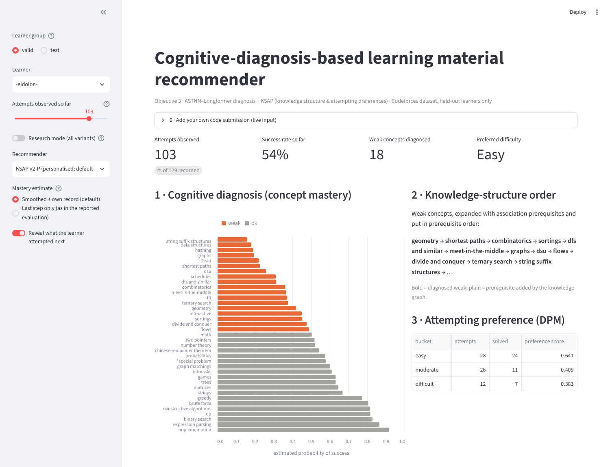
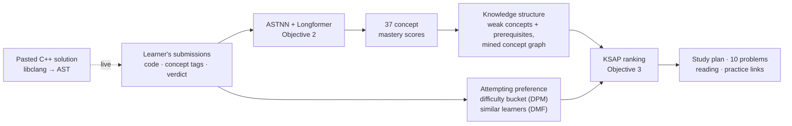
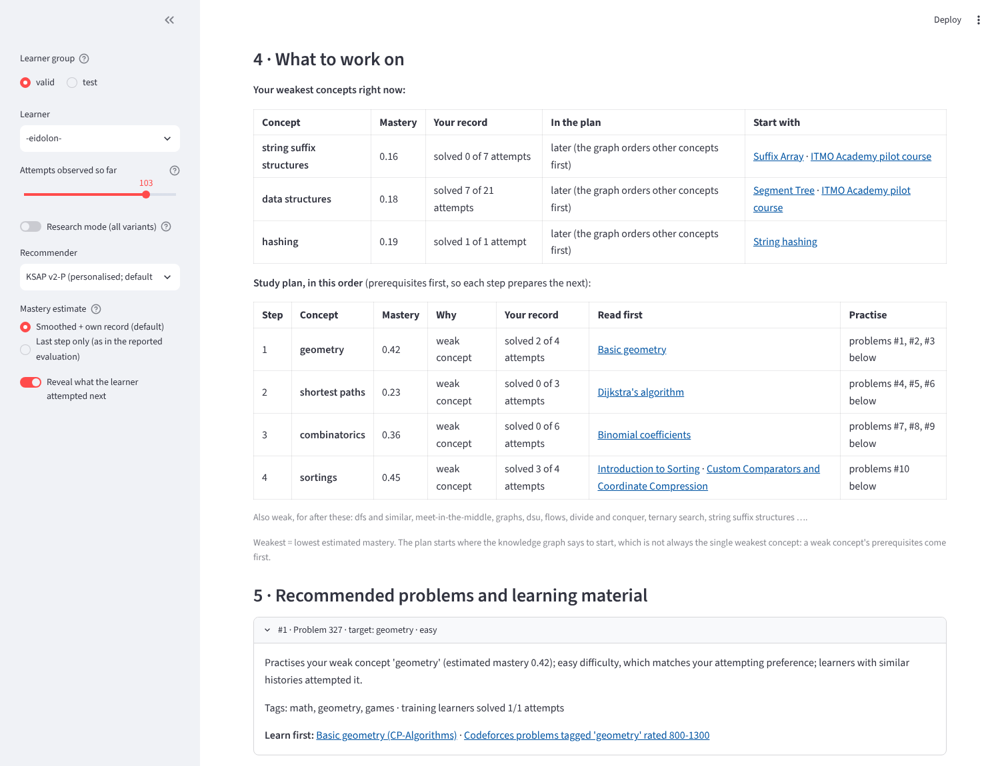

<div align="center">

# PKT Cognitive Diagnosis Recommender

**Diagnosing what a programmer doesn't know yet from their code, and telling them what to work on next.**


</div>

<p align="center">
  
</p>

The system reads a learner's Codeforces submissions as **code**, not just right or wrong. From that history it estimates their mastery of **37 programming concepts**, then builds a personalised study plan: which concepts to strengthen, in what order, with which problems and reading. Paste in a new C++ solution and the whole pipeline updates live.

| | |
|---|---|
| **Objective 2: Knowledge tracing** | **ASTNN + Longformer.** Each submission's abstract syntax tree is encoded by ASTNN and combined with its concept tags and verdict. A Longformer then models the learner's whole history. |
| **Objective 3: Recommendation** | **KSAP.** The diagnosed gaps are expanded through a mined concept graph, matched to the learner's difficulty preference, and ranked by deep matrix factorisation (collaborative filtering). Each problem comes with a reason and learning material. |

---

## Contents

- [How it works](#how-it-works)
- [Results](#results)
- [Quick start](#quick-start)
- [Reproducing every result](#reproducing-every-result)
- [Repository structure](#repository-structure)
- [Documentation](#documentation)

---

## How it works



1. **Diagnose.** The Longformer reads up to 200 past attempts. For each attempt it sees the statement trees of the code, the problem's concepts and the verdict. It outputs one mastery score per concept.
2. **Structure.** Concepts below 0.5 are weak. A concept graph mined from training learners (association rules over failed-concept baskets) adds the prerequisites the learner hasn't mastered and orders everything prerequisites-first.
3. **Prefer.** The learner's own success by difficulty picks a difficulty level. A DMF model trained on other learners scores which problems suit them.
4. **Recommend.** The page shows the learner's weakest concepts, a step-by-step study plan, and 10 unseen problems. Each problem has a one-line reason, reading (CP-Algorithms, USACO Guide, Codeforces EDU) and Codeforces practice filtered by topic and rating.

<p align="center">
  
</p>

---

## Results

All results are on **held-out learners**, never seen during training or model selection.

### Objective 2: Predicting the next attempt

| Model | Dataset | Predictions | AUC | ACC | F1 | MSE |
|---|---|---:|---:|---:|---:|---:|
| ASTNN + LSTM (baseline) | Codeforces (test) | 6,445 | 0.7035 | 0.6577 | 0.6806 | 0.2215 |
| **ASTNN + Longformer** | **Codeforces (test)** | 6,445 | **0.8361** | **0.7528** | **0.7594** | **0.1680** |
| ASTNN + LSTM (baseline) | PDKT (zero-shot) | 18,934 | 0.6161 | 0.5338 | 0.4909 | 0.2459 |
| **ASTNN + Longformer** | **PDKT (zero-shot)** | 18,934 | **0.7700** | **0.7497** | **0.5933** | **0.1835** |

The Longformer improves on the LSTM baseline by **+0.13 AUC on Codeforces**. Applied to a second dataset (PDKT, 584 learners from a different judge) with no retraining, it keeps a **+0.15 AUC** lead.

### Objective 3: Recommendation quality

The protocol on both datasets is the same:
- each test learner is evaluated at 5 points in their history (50–90%);
- the system sees only the attempts before that point;
- a recommendation counts as a hit if the learner later attempted it;
- "weak-concept targeting" is the share of the list aimed at the learner's own 6 weakest concepts.

**Codeforces: 22 test learners, 108 snapshots**

| Method | HR@10 | P@10 | R@10 | NDCG@10 | Weak-concept targeting |
|---|---:|---:|---:|---:|---:|
| Random | 0.120 | 0.013 | 0.013 | 0.014 | 0.25 |
| Popularity | 0.373 | 0.144 | 0.044 | 0.147 | 0.12 |
| DMF only (collaborative filtering) | 0.427 | 0.136 | 0.024 | 0.131 | 0.21 |
| KSAP v1 (paper-faithful) | **0.473** | 0.118 | 0.021 | 0.120 | 0.32 |
| KSAP v2 | 0.464 | 0.125 | 0.025 | 0.124 | 0.23 |
| **KSAP v2-P (personalised, demo default)** | 0.382 | 0.077 | 0.013 | 0.086 | **0.45** |

**PDKT: 202 test learners, 770 snapshots, all settings frozen from Codeforces**

| Method | HR@10 | P@10 | NDCG@10 | Weak-concept targeting |
|---|---:|---:|---:|---:|
| Random | 0.120 | 0.014 | 0.025 | 0.13 |
| Popularity | 0.233 | 0.035 | 0.083 | 0.22 |
| DMF only (collaborative filtering) | **0.638** | **0.167** | **0.396** | 0.20 |
| KSAP v1 | 0.253 | 0.042 | 0.081 | 0.39 |
| KSAP v2 | 0.258 | 0.042 | 0.082 | 0.39 |
| **KSAP v2-P** | 0.257 | 0.042 | 0.081 | **0.39** |

**What the numbers show**

- **Recommendations aim at each learner's gaps.** On both datasets KSAP targets the learner's weakest concepts significantly more than popularity. The difference is +0.11 on Codeforces (95% CI [+0.06, +0.17]) and +0.16 on PDKT ([+0.13, +0.20]).
- **Lists are personal.** With plain KSAP, 21 of 22 learners got the same first three topics; with v2-P, 3 of 22 did. v2-P also doubles weak-concept targeting (+0.22, CI [+0.16, +0.28]).
- **KSAP stays relevant on Codeforces.** It has the highest hit rate there.
- **There is a trade-off between remediation and relevance.** Learners rarely attempt their weakest topics next. On PDKT, a course judge where everyone follows the same assigned problems, "what similar learners did next" (DMF) predicts the next attempt best. KSAP deliberately trades some of that for remediation.

<details>
<summary><b>Diagnosis engine comparison: DKT, DKVMN and SAKT inside KSAP (Codeforces)</b></summary>

<br>

Each standard knowledge-tracing model was trained on the same data and used in place of the ASTNN-Longformer as KSAP's diagnosis engine. Everything else was kept identical.

| Diagnosis engine | Reads code | KSAP HR@10 | KSAP P@10 | KSAP NDCG@10 |
|---|:---:|---:|---:|---:|
| **ASTNN-Longformer** | ✓ | 0.464 | 0.125 | 0.124 |
| DKT | | 0.445 | 0.110 | 0.111 |
| DKVMN | | 0.482 | 0.123 | 0.121 |
| SAKT | | 0.518 | 0.137 | 0.137 |

None of the differences is statistically significant, so the KSAP framework is engine-agnostic. The ASTNN engine is the only one that can read code, which is what powers the live input in the demo. Details are in [KT_BASELINES.md](objective3/docs/KT_BASELINES.md).

</details>

---

## Quick start

```bash
git clone https://github.com/Sayyam-wad/PKT-Cognitive-Diagnosis-Recommender.git
cd PKT-Cognitive-Diagnosis-Recommender
pip install -r requirements.txt     # Python 3.11 recommended; for a GPU, install the matching CUDA build of PyTorch first
python setup_data.py                # downloads the dataset (85 MB) and puts every input in place

cd objective3
python -m streamlit run content/pkt/app.py      # the web prototype
python -m pytest -q                             # 90 tests
```

`setup_data.py` downloads `codeforces.zip` from the original PKT repository ([pkt-attn/pkt-attn](https://github.com/pkt-attn/pkt-attn)) and verifies its SHA-256. It then extracts the Objective 2 training inputs and copies the trained checkpoint into the Objective 3 bundle. If you already have the archive, use `python setup_data.py --zip path/to/codeforces.zip`.

**Using the demo:** pick a learner and how many of their attempts the system has seen. Then read sections 1–5 of the page: diagnosis, concept order, difficulty preference, what to work on, and recommendations. Open **section 0** to paste your own C++ solution; it is converted into the model's AST format and everything updates. Optionally, `python content/pkt/scripts/fetch_cf_practice.py` adds three named Codeforces practice problems to every recommendation.

---

## Reproducing every result

### Objective 2

The trained checkpoints are already in `objective2/results/`, so you can evaluate straight away.

**Evaluate (CPU or GPU).** Run from `objective3/pdkt_crossdataset/`:

```bash
cd objective3/pdkt_crossdataset
# ASTNN + Longformer, Codeforces test  ->  AUC 0.8361  ACC 0.7528  F1 0.7594  MSE 0.1680
python evaluate_original.py ../../objective2/data/codeforces/astnn/astnn_test ../../objective2/data/codeforces/astnn/node_w2v_128 ../../objective2/results/best_longformer_model.pt
# ASTNN + LSTM, Codeforces test        ->  AUC 0.7035  ACC 0.6577  F1 0.6806  MSE 0.2215
python evaluate_lstm.py ../../objective2/data/codeforces/astnn/astnn_test ../../objective2/data/codeforces/astnn/node_w2v_128 ../../objective2/results/best_lstm_model.pt

# PDKT zero-shot: rebuild the full PDKT file (584 learners) from the included split, then evaluate
python full_test_file.py
python evaluate_original.py work/pdkt_astnn_test ../../objective2/data/codeforces/astnn/node_w2v_128 ../../objective2/results/best_longformer_model.pt   # AUC 0.7700
python evaluate_lstm.py     work/pdkt_astnn_test ../../objective2/data/codeforces/astnn/node_w2v_128 ../../objective2/results/best_lstm_model.pt        # AUC 0.6161
```

These scripts use the original model code and settings. On a CUDA machine you can also use the original evaluation script, `cd objective2 && python -m models.astnn.main_metrics`.

**Train (GPU recommended).** Run from `objective2/`:

```bash
cd objective2
python -m models.astnn.main                              # ASTNN + Longformer, tuned hyper-parameters, 50 epochs (add --gpu -1 for CPU: several hours)
python -m models.astnn.main_lstm --dataset codeforces    # ASTNN + LSTM baseline (saves to results/pdkt_lstm/)
```

Training writes the best validation checkpoint to `objective2/results/best_longformer_model.pt`, replacing the shipped one. `git checkout objective2/results` restores the original. Run `python setup_data.py` again afterwards so Objective 3 uses the newly trained checkpoint.

### Objective 3

Run from `objective3/`. The saved output of every run is in `content/pkt/results/`, so you can compare your outputs file by file.

```bash
cd objective3

# Codeforces main result: KSAP v1/v2, baselines and ablation   (compare with content/pkt/results/ksap_v2_test/)
python content/pkt/scripts/v2_final.py --archive data/codeforces.zip --bundle content/pkt/results/ksap_hf_v1 \
  --cache content/pkt/results/ksap_last_inputs/mastery_cache.json \
  --full-mastery content/pkt/results/ksap_last_inputs/valid_full_mastery.json \
  --split test --set main --output-dir my_results/main
# the same command with --set personalised gives KSAP v2-P   (compare with content/pkt/results/ksap_v2p_test/)

# PDKT: diagnosis inputs, then KSAP with every setting frozen   (compare with content/pkt/results/pdkt_ksap_test_main/)
python pdkt_crossdataset/mastery_inputs.py
python content/pkt/scripts/v2_final.py --archive pdkt_crossdataset/pdkt.zip --bundle content/pkt/results/ksap_hf_v1 \
  --training-mastery pdkt_crossdataset/work/training_mastery.json \
  --full-mastery pdkt_crossdataset/work/valid_full_mastery.json \
  --cache pdkt_crossdataset/work/mastery_cache.json \
  --split test --set main --output-dir my_results/pdkt_main

# DKT / DKVMN / SAKT (3 seeds each; about an hour on CPU)
python content/pkt/scripts/kt_baselines.py --archive data/codeforces.zip --out my_results/kt_baselines

# diagnosis quality: last-step vs smoothed vs calibrated   (compare with content/pkt/results/ksap_calibrated/diagnosis_test.txt)
python content/pkt/scripts/diagnosis_eval.py --split test \
  --cache last=content/pkt/results/ksap_last_inputs/mastery_cache.json \
          ema=content/pkt/results/ksap_ema_inputs/mastery_cache.json \
          calibrated=content/pkt/results/ksap_calibrated/mastery_cache.json

# C++ -> AST converter: exact match against the dataset's own trees (6/6)
python validation/validate_converter.py
```

The full command list for every experiment is in each write-up under [Documentation](#documentation).

---

## Repository structure

```
├── setup_data.py                 one-time data setup (download + checksums)
├── objective2/                   knowledge-tracing model
│   ├── models/astnn/             ASTNN + Longformer / LSTM: model, data loader, training and evaluation scripts
│   └── results/                  trained checkpoints
├── objective3/                   recommender
│   ├── content/pkt/
│   │   ├── app.py                Streamlit web prototype
│   │   ├── recommendation/       diagnosis, concept graph, DPM, DMF, ranking, learning material, live input
│   │   ├── preprocessing_live/   C++ → ASTNN converter (libclang 13, validated exact)
│   │   ├── scripts/              evaluation and experiment scripts
│   │   └── results/              saved bundle and every result
│   ├── tests/                    90 automated tests
│   ├── docs/                     experiment write-ups
│   ├── pdkt_crossdataset/        second dataset: conversion pipeline + prepared split
│   └── validation/               converter exact-match validation
└── assets/                       screenshots
```

---

## Documentation

| Write-up | Contents |
|---|---|
| [KSAP_V2_RESULTS.md](objective3/docs/KSAP_V2_RESULTS.md) | Recommender design, evaluation protocol, main results, ablation, personalisation |
| [KT_BASELINES.md](objective3/docs/KT_BASELINES.md) | DKT, DKVMN and SAKT as knowledge-tracing models and as KSAP's diagnosis engine |
| [DIAGNOSIS_CALIBRATION.md](objective3/docs/DIAGNOSIS_CALIBRATION.md) | Calibrated concept diagnosis |
| [MASTERY_SMOOTHING.md](objective3/docs/MASTERY_SMOOTHING.md) | Stable mastery estimates for live input |
| [OPTION_C_FEASIBILITY.md](objective3/docs/OPTION_C_FEASIBILITY.md) | C++ → AST converter and live code input |
| [PDKT_OBJECTIVE3.md](objective3/docs/PDKT_OBJECTIVE3.md) | Objective 3 on the PDKT dataset |
| [pdkt_crossdataset/README.md](objective3/pdkt_crossdataset/README.md) | Objective 2 on PDKT and how the data was prepared |
| [objective2/README.md](objective2/README.md) | Model architecture, settings and scripts |

## Data

- **Codeforces** (55 learners, 37 concepts): from [pkt-attn/pkt-attn](https://github.com/pkt-attn/pkt-attn). It is downloaded by `setup_data.py`, not stored in this repository.
- **PDKT** (584 learners, C++ submissions): only the processed split (`objective3/pdkt_crossdataset/pdkt.zip`) is included.
